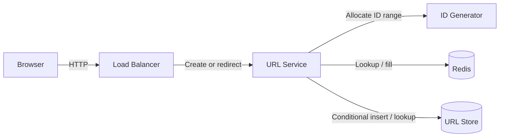

# Clear reference solutions: product and implementation plan

## Outcome

Every reference approach should let a learner answer these questions without guessing:

1. What should I enter in Requirements and Estimation?
2. Which entities do I create, what are their keys, and where are they stored?
3. Which APIs or message contracts do I define, and which component owns each one?
4. Which components do I put on the canvas, how do I configure them, and what connects to what?
5. How does each important request travel through the design?
6. What does the completed HLD look like, and why does it satisfy the requirements?

The solution should teach the same stages used in the practice workspace. A diagram and a short summary alone do not meet this goal.

## Findings from the repository

Audit date: November 2, 2026. Read all 61 solution write-ups, audited their graph files, and inspected the content loader, schemas, validation, solution reader, reference comparison, and workspace editors.

| Area | Current state | Consequence |
| --- | --- | --- |
| Coverage | 30 problems, 61 approaches, 40 diagrams | 21 approaches have no final HLD. |
| Explanation | Write-ups contain roughly 25–94 whitespace-separated words, excluding frontmatter | They describe an idea but rarely explain how to construct it. |
| Entities | 29 entity definitions; none has `storeNodeId` | The learner cannot see which database owns a record. |
| API detail | 57 endpoints in graph files; only 29 have a request or response example | Many contracts need authoring. The reader also hides existing request, response, and status-code fields. |
| Connections | 334 edges; none has a linked API | APIs and architecture are presented as separate artifacts. |
| Missing sections | Of the 40 graph files, 6 have no APIs and 19 have no entities | Each needs an appropriate contract/state model, or an explicit explanation of applicability. |
| Reference viewer | Diagram appears before the walkthrough; nodes cannot be selected | Learners cannot inspect responsibilities, notes, or complete config from the reference diagram. |
| Authoring workflow | Entity storage choices require existing canvas nodes, but Data Model comes before Design | A learner must move ahead to create a store, then return. APIs already have an Add service/gateway shortcut. |
| Validation | Content validation passes: 239 tests, including 200 core | Existing checks protect structural correctness, but allow missing diagrams and incomplete explanations. |

Relevant entry points:

- `components/solutions/SolutionsView.tsx`: solution page and current API/entity rendering.
- `components/canvas/GraphViewer.tsx`: reusable reference diagram viewer.
- `lib/schema/problem.ts`: reference, entity, and solution-file schemas.
- `lib/content/problemDir.ts`: Markdown and graph assembly.
- `lib/problems/validate.ts`: cross-references and reference core-test checks.
- `components/workspace/stages/Entities.tsx` and `Apis.tsx`: matching practice stages.

`CLAUDE.md` references `PHASE-2.md`, but that file is absent from this checkout. This plan uses the implemented application and available spec.

## Proposed solution experience

Keep the existing approach selector and My solutions tab. Inside each approach, provide a persistent section navigator and an ordered walkthrough:

**Overview → Requirements → Estimation → Entities → APIs → Build the HLD → Request flows → Final HLD → Trade-offs.**

Use one scrollable document with section anchors, rather than hiding each section behind another level of tabs. Desktop can keep a diagram preview beside the current section; smaller screens stack the diagram and content. The final diagram has its own full-width section and a persistent “View final HLD” shortcut.

Each stage explicitly distinguishes:

- **What to add:** the actual entries or components.
- **Where it belongs:** the workspace stage, owner service, or storage node.
- **Why:** the requirement or access pattern that motivates it.

### Requirements and estimation

Show the functional requirements, measurable non-functional requirements, and scope cuts. Identify optional features separately so learners can see the minimum complete design.

Show estimation assumptions, formulas, results, and their design implications. For example, explain how a read/write ratio motivates caching instead of presenting an unexplained QPS value. Retain shared problem scale as the baseline; author approach-specific assumptions only when they differ.

### Entity and storage cards

For each entity or state structure, show:

- Name, purpose, and fields with types and key annotations.
- Database/cache/object store resolved from `storeNodeId` to its readable name.
- Primary/partition/sort keys, important indexes, and constraints where relevant.
- Main reads and writes, plus relationships to other entities.
- Retention or TTL when it affects correctness.
- A short instruction such as “Data Model → Add entity → Stored in: URL Store.”

Distinguish durable records from derived cache entries and transient state. Infrastructure questions may need token buckets, partitions, offsets, leases, or in-memory generator state instead of business tables. Explain that choice explicitly.

### API and contract cards

Group contracts by the component that implements them. Show method/path or operation, purpose, owner, request example, response example, success/errors, and applicable auth, pagination, idempotency, and rate-limit behavior.

Use the existing `request`, `response`, `statusCodes`, and flags before adding fields. Show “No request body” where appropriate rather than leaving an unexplained blank.

Include WebSocket messages, internal RPCs, and events where the problem requires them. A crawler does not need an invented public CRUD API, but its seed submission or worker contract should be explained. A limiter needs its check operation and state transition, even if it is implemented as gateway middleware.

API ownership belongs to the implementing service; routing through a load balancer does not make the load balancer its owner. Validate allowed owner types according to contract role, including legitimate infrastructure operations.

### Build the HLD

Provide explicit numbered construction steps. Each step includes:

1. Catalog component type and the label to assign.
2. Position relative to existing components: left, middle, right, or background lane.
3. Important configuration and why it is chosen.
4. Connections to add: source, destination, protocol, sync/async, operation, and label.
5. APIs or entities attached to the new component.
6. The requirement this step satisfies.

Render the intermediate diagram by revealing authored node/edge IDs from the final graph. This keeps the construction sequence and final HLD consistent without maintaining separate diagrams for every step. Show enough context around highlighted components to keep the layout understandable.

### Request flows and final HLD

Author named flows such as Create, Read/cache hit, Read/cache miss, Retry, and Expiry. Each flow is an ordered sequence of concrete actions with explicit branches and outcomes. Selecting a flow highlights its nodes and edges and shows numbered explanations alongside it.

The final HLD supports zoom, fit, an enlarged view, and a readable legend. Clicking a component reveals its responsibility, configuration, owned APIs, stored entities, and notes. Clicking a connection reveals its protocol, mode, operation, and linked contract.

Some connections carry several APIs, so do not force one edge per endpoint. Keep the existing optional `apiId` for a specific contract; flow metadata can identify which API uses a shared route. Database and queue connections do not need a public API link merely to pass a completeness check.

Finish with bottlenecks, failure behavior, trade-offs, and a comparison with the other approaches to the same problem. Explain the condition under which an alternative is preferable.

## Concrete example: URL shortener

The completed walkthrough would specify these entries:

| Workspace location | What to add | Ownership or configuration |
| --- | --- | --- |
| Data Model | `UrlMapping`: `code PK`, `long_url`, `created_at`, `expires_at?` | Stored in URL Store; point lookup by code; conditional insert for uniqueness. |
| APIs | `POST /v1/urls` | Owned by URL Service; request `{longUrl, alias?, expiresAt?}`; `201` with `{code, shortUrl}`; `400` invalid URL; `409` alias already used. |
| APIs | `GET /{code}` | Owned by URL Service; no body; `302` with `Location`; `404` absent; `410` expired. |
| Design | Browser → LB → URL Service | Public HTTP path; stateless service instances behind the LB. |
| Design | URL Service → ID Generator | Allocate ranges, then assign codes locally; explain uniqueness, range exhaustion, and guessability. |
| Design | URL Service → Redis | Cache-aside lookup and fill; TTL bounded by the mapping's expiry. |
| Design | URL Service → URL Store | Durable create and lookup; partition key `code`. |

This example follows the current problem's scope without requiring user accounts. The existing reference's `auth: true` and `owner_id` should be reconciled with the out-of-scope account requirement when authoring it, rather than copied without explanation.

Construction sequence:

1. Add Browser, LB, and URL Service; connect the public request path.
2. Add URL Store; bind `UrlMapping` to it and connect the service.
3. Define the two endpoints under URL Service.
4. Add ID Generator and describe range allocation and atomic mapping creation.
5. Add Redis and explain the cache-hit and cache-miss branches.
6. Configure availability, expiry checks, and capacity using the stated estimates.

Illustrative final HLD:



The miss path is **Service → Redis miss → Service → URL Store → Service → Redis fill → HTTP redirect**. Redis does not directly read the database. Expired mappings must be rejected even if physical TTL deletion is delayed. Range generation also needs an explicit policy for code predictability; base62 encoding alone does not address it.

The published app diagram remains a React Flow graph. Mermaid here only illustrates the target explanation.

## Content model and technical design

Preserve the existing canonical content layout and add one educational metadata file per approach:

```text
content/problems/<problem>/solutions/
  <approach>.md                 # Expanded narrative and trade-offs
  <approach>.graph.json         # Final graph, APIs, entities, and owner/storage links
  <approach>.walkthrough.json   # Explanation metadata referencing those objects
```

The walkthrough sidecar should contain a version and:

- `overview`: suitability and main design decisions.
- `estimation`: assumptions, calculations, units, and implications.
- `components`: node IDs with responsibilities and configuration rationale.
- `entityDetails`: unique entity names with purpose, access patterns, constraints, and relationship explanations.
- `apiDetails`: API IDs with purpose and rationale beyond the existing contract fields.
- `buildSteps`: ordered instructions referencing node, edge, API, and entity identifiers.
- `flows`: ordered steps referencing nodes/edges and optional APIs, with explanations and branch outcomes.
- `failureCases`: scenario, affected components, handling, and trade-off.
- `sectionApplicability`: explicit rationale for a section that truly does not apply.

Do not duplicate graph positions, endpoint payloads, entity field definitions, or owner names in the sidecar. Resolve them from the existing graph file. Require entity-name uniqueness within an approach for these references; introducing persisted entity IDs is unnecessary for this change.

Add Zod schemas under `lib/schema` and assemble metadata in `lib/content/problemDir.ts`. Make the new field optional for legacy content during migration; once an approach declares the new walkthrough version, require it to meet all completeness checks. At rollout completion, require every published approach to use that version.

Keep this metadata on reference approaches. Avoid expanding persisted attempt, sync, and My solutions schemas just to support reference teaching content.

Split the solution page into focused components: section navigation, entity cards, API cards, build steps, flow reader, and component inspector. Reuse these renderers for the reference section inside Review so the two entry points do not drift.

Extend the existing graph viewer with optional local selection and highlights. Reference interaction must not alter `useWorkspaceStore` or an active attempt. Audit shared node renderers, which currently read workspace highlights, and give reference viewers their own display state. Keep the default viewer behavior compatible for other consumers.

## Practice-workspace improvements

1. Add an **Add store** shortcut in Data Model, analogous to Add service in APIs. Create the actual catalog-backed canvas node so the storage selector works immediately. Offer the existing storage types and let the learner choose and name the store.
2. Add brief stage guidance about ownership and where those objects appear on the canvas. Keep practice guidance generic until the existing solution gate is unlocked.
3. Add **Show on canvas** navigation for an entity's store or an API's owner. Reuse existing focus behavior where possible.
4. Keep the existing attempt stages and scoring rules. A learner can construct their own valid alternative; reference steps are teaching material rather than exact-match grading criteria.

## Validation and acceptance criteria

Extend `pnpm validate:content` to check:

- Every fully migrated approach has a nonempty final graph and all required walkthrough sections, or a justified applicability exception.
- Node, edge, and API IDs are unique; referenced nodes, edges, APIs, and entity names exist.
- Entity `storeNodeId` targets an appropriate storage component; API owners can implement the declared contract.
- An edge's linked API exists and is owned by its target, matching the current edge-inspector convention.
- Construction steps only expose edges when their endpoints are available and cumulatively cover the final graph.
- Flow steps reference an existing, directionally valid route; branch paths are checked separately. Document return behavior without inventing reverse edges solely for response traffic.
- Required contract details and meaningful entity fields are supplied, with explicit “no body” or non-applicability where appropriate.
- Every reference still passes the problem's core tests and the existing reference lint checks.

Automated checks cannot establish that an explanation is technically correct. Review each walkthrough for agreement among requirements, estimates, contracts, state, and flows. Pay particular attention to expiry, atomicity, retry behavior, ordering, and failure boundaries.

Completion means a learner can reproduce every published approach from its instructions and identify the owner/store/path for each item. No migrated solution should silently show “Not specified” or omit its final HLD.

## Delivery sequence

| Phase | Deliverable | Acceptance |
| --- | --- | --- |
| 1. Expose existing information | Show API owners, payloads, status codes; entity stores; inspectable reference components. Add the Data Model store shortcut. | Existing populated fields are visible; a learner can create and bind a store without leaving Data Model; reference selection does not change an attempt. |
| 2. Establish the walkthrough format | Schemas, loader, conditional completeness checks, and one complete URL-shortener approach. | The example fully answers what, where, and why; invalid references fail validation. |
| 3. Build guided reading | Section navigation, progressive HLD construction, flow highlighting, final HLD, and shared Review rendering. | URL shortener works through the entire reader at desktop and narrow widths; diagram and text remain consistent. |
| 4. Prove the format on different systems | Fully author chat, ticket booking, and rate limiter examples. | Handles WebSockets, concurrency/expiry, and infrastructure contracts without forcing everything into REST/SQL. |
| 5. Complete the question bank | Bring one recommended approach for every remaining question to the same standard, then complete every alternative. Add all 21 missing diagrams. | All 30 questions have a complete recommended walkthrough; final release covers all 61 approaches. Alternative approaches explain their changed contracts/state/flows rather than copying the primary design. |

For implementation phases, run content validation and the project's required typecheck, lint, and test commands. Add targeted tests for the new cross-reference rules and flow/build-step derivation. Manually verify navigation, inspectable API/entity detail, diagram readability, theme behavior, and solution-unlock behavior. Broaden checks when changes introduce new concerns.

The first useful delivery is Phase 1 plus one complete vertical slice. A repository-wide wording rewrite should follow only after that slice proves the content structure and reader work together.

## Scope of this change

This is a reference-content and learning-experience improvement using the existing Next.js, Zod, static content, and React Flow architecture. It does not require a new backend, database migration, runtime AI generation, or replacement diagram library. The main effort is consistent authoring and technical review across all 61 approaches.
